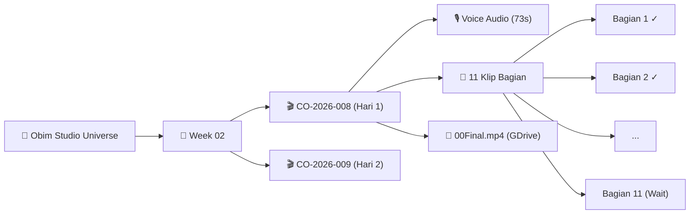

# 🌌 Rencana Tampilan Alternatif: Interactive Node Graph & AI Command Center

Dokumen ini mendokumentasikan perencanaan visual, struktur komponen, dan pemetaan konsep desain alternatif untuk **CeritaObim Studio** yang akan diimplementasikan setelah seluruh alur kerja inti (MVP) selesai secara menyeluruh.

---

## 1. Ringkasan Konsep & Visi Desain
Mengubah antarmuka produksi video CeritaObim dari tabel konvensional menjadi **"Interactive Content Universe & AI Command Center"** bernuansa gelap (*deep navy / emerald dark glassmorphism*) dengan tiga pilar antarmuka:

1. **Interactive Node Network & Branching Tree (Pusat Layar)**:
   * Node *glowing pearl/orb* yang merepresentasikan tema besar, batch mingguan, hingga nomor konten (`CO-2026-XXX`).
   * Setiap konten dapat "mekar" (*radiate/branch out*) memancarkan berkas serat optik ke 11 klip bagian (*Bagian 1 s/d Bagian 11*), audio voiceover, dan video master `00Final.mp4`.
   * Indikator warna dinamis: Hijau bercahaya (selesai & tersinkron GDrive), Oranye berdenyut (menunggu klip/proses), Abu-abu (belum dimulai).

2. **Glassmorphic Slide-Out Inspector Panel (Sisi Kanan)**:
   * Panel kaca melayang (*frosted glass*) dengan visualisasi grafik audio (*sentiment / waveform*), metrik durasi, transkrip, copy-prompt button, dan status drive link.

3. **Floating AI Command Dock (Bagian Bawah)**:
   * Bar pencarian dan perintah cerdas melayang di bagian bawah untuk kontrol cepat: *“Rakit 00Final CO-2026-008”*, *“Copy prompt Bagian 5”*, atau *“Generate tema minggu depan”*.

---

## 2. Foto Referensi Desain Tersimpan

Seluruh foto referensi desain telah disimpan secara permanen di direktori proyek:
📁 `docs/design_references/graph_ui/`

1. **`01_interactive_node_network.png`**:
   Peta jaringan node melingkar (konsep galaksi topik & relasi konten antar minggu).
2. **`02_branching_tree_inspector.png`**:
   Pohon percabangan garis serat optik dari satu konten ke sub-bagian dan panel inspeksi kanan lengkap dengan metrik & waveform.
3. **`03_tree_structure_canvas.png`**:
   Struktur percabangan minimalis pada kanvas gelap dengan panel kanan kosong siap isi.
4. **`04_full_ai_command_center.png`**:
   Tampilan lengkap *command center* dengan dock prompt chat AI di bagian bawah.

---

## 3. Pemetaan ke Domain CeritaObim Studio

| Elemen Desain Referensi | Adaptasi di CeritaObim Studio |
| :--- | :--- |
| **Central Law / Regulation Node** | **Konten Episode** (e.g. `CO-2026-008 - Mengapa Jam Berputar ke Kanan?`) |
| **Branching Entities / Services** | **Pipeline Produksi**: Narasi, Voice Audio, Klip Scene, Master Assembly |
| **Radiating Sub-Nodes** | **11 Bagian Klip Origami Video** (`Bagian 1` s/d `Bagian 11`) |
| **Right Detail Panel** | **Scene Inspector**: Text prompt, visual action, audio player, GDrive download button |
| **Sentiment / Status Bar** | **Audio Waveform & Durasi Scene** (e.g. 9s per bagian, total 73s) |
| **Bottom Chat / AI Input** | **CeritaObim Studio Quick Assistant** (Trigger retranscribe, trigger assemble, copy prompt) |

---

## 4. Rencana Implementasi Teknis (Pasca-MVP)

1. **Dual-View Toggle**:
   * Menambahkan switch di navigation bar atas:
     * 📊 **Table View** (antarmuka default yang ringkas, ramah layar HP/360px).
     * 🌌 **Galaxy / Graph View** (antarmuka visual interaktif ini untuk pengalaman desktop/tablet imersif).
2. **Pilihan Library Kanvas**:
   * `@xyflow/react` (React Flow) dengan kustomisasi custom node SVG bercahaya, atau
   * HTML5 Canvas / SVG D3 Force Tree dengan akselerasi GPU.
3. **Styling & Efek**:
   * Tailwind CSS dengan utility `backdrop-blur-2xl`, linear-gradient glow, dan border neon halus.
   * `framer-motion` untuk transisi ekspansi cabang saat node diklik.

---

> [!NOTE]
> Perencanaan ini telah dicatat dan diarsipkan. Eksekusi teknis akan dimulai setelah seluruh fitur inti perakitan, sinkronisasi Google Drive/Sheets, dan validasi produksi harian telah rampung 100%.
